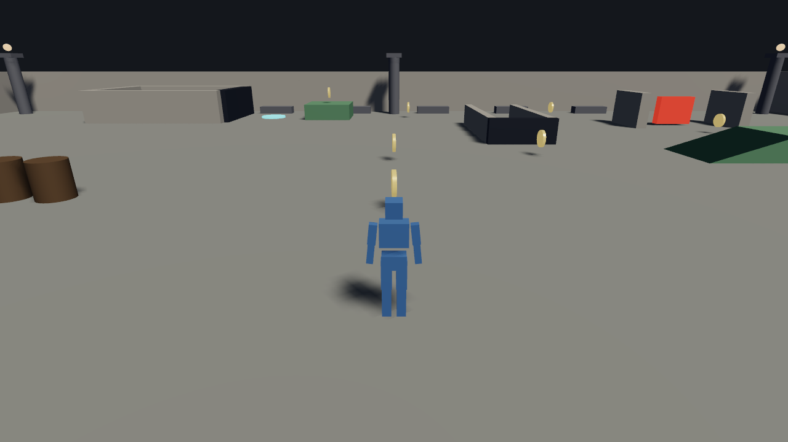

# Fynkel Reference Game

The first reference game of the [Fynkel Engine](../../README.md) (blueprint
§19.2d item 14): a Tier 1 collect-'em-all in one authored scene, the
**Playground** — walk a rigged character through an arena, pick up ten coins, get
past a sweeping blade and a lane of rolling balls, jump onto a block, open a
gate with a switch. Everything the engine offers a Tier 1 game is used
once, on purpose, so the project doubles as the worked example the docs
point at.



```sh
fynkel run                       # validate, cook, then flutter run on macOS (WASD/mouse or a gamepad)
fynkel run -d <iphone>           # the same on a device: the app carries the cooked cache (fynkel_cache/, bundled)
flutter test                     # test/game_test.dart: the world loads, the recorded route collects all ten coins, the character is posed from the controller, hazards kill, restart resets
fynkel validate                  # documents, references, lock
fynkel test --headless --input test/collect_all.input.json --steps 1400   # the route on the Rust host (no Dart behaviours: the runtime walks the controller)
fynkel render --out renders/playground.png --size 1280x720 --steps 40    # the scene as a picture, no window (40 ticks in: the character idles)
```

**Controls** — walk: WASD / left stick / overlay stick · look: mouse (click
the view to capture it, Escape releases) / right stick · jump: Space / A ·
sprint: Shift / LB · use: E / X · wave: F / B · restart: R / Y · pause:
Escape / menu · F1 stats, Q quality profile.

## The world

`assets/scenes/playground.scene.json` is generated by `tools/playground.py`
(deterministic ids, stdlib only; CI regenerates it and diffs) from a kit of
seven meshes `tools/kit.py` writes as `assets/models/kit.glb` and `fynkel
import` splits into `mesh/0..6`, and the player's rigged character
`tools/character.py` writes as `assets/models/character.glb` (a skinned
body of eleven boxes on an eleven-joint skeleton with idle, walk, run and
jump clips → `mesh/0`, `skin/0`, `anim/0..3`) — the repository carries no
binary of unknown origin. 168 entities: a 60 m arena of walls, pillars
with point lights, benches, planters, trees and a fountain (113 static
meshes, all colliders); 22 rigid bodies (a crate pyramid, a pen of balls,
barrels); 16 PBR materials; a sun with shadows and a cool ambient; the
player with its skinned `Body` (`fynkel.Skin`), the joint entities
`hips` → `spine` → `head` … in their bind pose (the visor hangs off
`head`), a `fynkel.Animator` playing the locomotion blend space
(`assets/models/player.blend.json`: idle, walk, run along `speed`,
phase-synced; M3-19c) and, on the `spine`, the additive wave layer — or,
opt-in, a downloaded character: `fynkel import Idle.fbx Walking.fbx
"Fast Run.fbx" Jumping.fbx --rig hero` writes `hero.rig.json` (the first
file's skeleton, every file's clip, matched by bone name; rename its
clips to `idle`, `walk`, `run`, `jump`, add `markers` for the footsteps,
a `wave` is optional) and `python3 tools/playground.py --hero
assets/models/hero/hero.rig.json` instances the rig's hierarchy under
the Player (`prefab: { asset: <rig>, sub: "prefab" }`, M3-19b) with the
blend space over the rig's `anim/idle` … (`--hero <file.glb>` still
takes one glTF whose `anim/0..3` are idle, walk, run, jump, the order
docs/animation.md's Blender recipe builds a Mixamo set in), never
committed — rerun without `--hero` first. The route: two
coins ahead, a ramp onto a platform (coins 3–4), a corridor swept by an
`Oscillate` blade whose child sensor is a `hazard` zone (coins 5–6), a lane
where an `Emitter` launches a dynamic ball prefab every 4 s (its sensor is
a hazard too; coins 7–8), a block to jump onto (coin 9), a switch pad and
the gate it opens (coin 10). Coins are a prefab instantiated ten times in
the scene (`Rotator`, a `collect` trigger zone, `game.Collectible`).

## The game (Dart)

- `lib/game/player.dart` — `game.Player`: walks the `fynkel.CharacterController`
  from the `move` action in the frame of the `fynkel.ThirdPersonCamera`
  rig (the same maths the runtime uses for a controller with named
  actions, so `fynkel test --headless --input` walks the route too), sprints,
  jumps on the press while grounded, dies on a `hazard` zone or below
  `fallY` (a transform write teleports the controller back to the start),
  restarts on `restart`, keeps the clock. Poses the character from the
  same state: `animation.setParameter('speed', v)` every tick with the
  controller's planar speed — the blend space mixes idle, walk and run
  from it —, `animation.play(jump, looping: false)` on the jump and a
  crossfade back on landing, the wave layer played once on `wave`, the
  walk's and run's footstep markers counted for the HUD — the clips are
  authored in place, the controller moves the entity
  (`docs/animation.md`).
- `lib/game/collectible.dart` — scores on `onZoneEnter('collect')`, spawns the
  `burst` prefab at runtime (`world.instantiate`; six small bodies kicked
  apart with `applyImpulse`, gone by their `LifetimeDespawn`), destroys its
  own prefab instance (the anchor entity: `world.byEntity(gameObject.parent)`).
- `lib/game/switch.dart` + `gate.dart` — the pad's `switch` zone shows a hint
  (a `ProjectedAnchor` over the pad) while the player stands on it; `E`
  opens the gate, which slides its static collider up over 1.2 s.
- `lib/game/game_state.dart` — the `GameModel` the HUD binds: coins, total,
  won, the clock, deaths, footsteps, the hint, paused. `lib/main.dart` is the app:
  `FynkelGameView`, the counter, the win and pause banners, the touch
  overlay, mouse capture on click.

`test/collect_all.input.json` (from `tools/route.py`) is the recorded input
stream `test/game_test.dart` replays: all ten coins, no deaths, the gate
open, the sparks seen, 23.3 s of game time in well under a second.
`AGENTS.md` describes the layout, every command and the validate → codegen →
build → test loop for tools and AI agents (and is a good tour for people).
