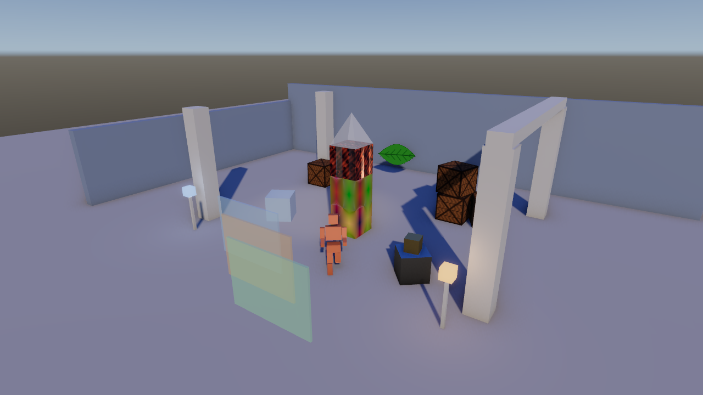

# Fynkel Showcase

The renderer's example scene: one project that exercises what
`fynkel_render` can do, so every renderer milestone has a picture to look
at and compare. It is a normal Fynkel game (created by `fynkel create`,
then authored): a Flutter app plus `fynkel.project.json`, an `assets/`
tree of strict JSON documents and the Fynkel CLI.



What is in the scene (`assets/scenes/main.scene.json`):

- a low evening **sun** (4 000 lux, 32° up) casting the one shadow map
  (four cascades in it since R1),
  long shadows from the pillars, the ledge and the robot; two crates show
  the per-mesh opt-outs (`Crate No Cast`, `Crate No Receive`)
- a warm **spot light** over the robot, a warm and a cool **point light**
  on lamp posts with emissive lamp cubes
- an **`Environment`** whose equirectangular **sky** is an HDR image
  (`textures/sky.hdr`, generated by `tools/sky.py`: a blue zenith into a
  bright horizon, a warm ground and the sun as a disc where the scene's
  `Sun` stands) — the backdrop *and* the light, since the cook prefilters
  it into the environment cubes the renderer samples (E1); the
  blue-tinted constant ambient stays as the fallback for a project whose
  sky is an 8-bit image
- **materials**: a rough floor and walls, textured crates (`crate.png`),
  the rusted robot head with base colour, normal and metallic-roughness
  maps, gold and chrome blocks (metals that read as metal since E1:
  the sky in the top face, the ground in the sides), three overlapping **blend** glass panels and a
  glass cube (the transparent sort), a **mask** leaf card (`leaf.png`,
  double-sided)
- the **robot** from the fixture glTF, re-authored as a hierarchy (body
  in the glTF's own textured material, rusted head, the antenna pyramid)
  spinning under the spot (`game.Spinner`)
- the **runner**: the reference game's rigged character
  (`assets/models/character.glb`, a byte copy of what
  `examples/reference_game/tools/character.py` generates — CI compares
  them), a skinned body of eleven boxes over an eleven-joint skeleton:
  `Runner` instances the file's own hierarchy — `prefab: { asset,
  sub: "prefab" }`, so `Character` → `Body` (with the `fynkel.Skin`) and
  `hips` → `spine` → `head`, the limbs, are the glTF's nodes — with the
  suit as a material override on the body's renderer and a
  `fynkel.Animator` looping the `run` clip in place (M3-19a; before it
  the same tree was authored by hand) — the skinned pipeline variants,
  the joint palette and a skinned caster in the shadow map (M3-19)
- a **camera** that orbits the scene (`game.Orbit`, `lib/game/orbit.dart`)
  so shadows and the transparent sort are seen moving; its authored
  transform is the orbit's start pose, so `fynkel render` (which runs no
  Dart) shows the same view the app opens on
- three **quality profiles** (`low`: no shadows, MSAA 1, scale 0.75;
  `medium`: 2048² shadows, MSAA 4; `high`: 4096², MSAA 4, scale 1.5,
  anisotropy 16)

```sh
fynkel run                       # validate, cook, then the app: Q cycles quality, Space pauses the orbit, A/D (or a stick) scrub it
fynkel run -d <iphone>           # the same on a device: the app carries the cooked cache (fynkel_cache/) as assets
fynkel render --out render.png --steps 10   # the same view as a PNG after 10 ticks (the runner mid-stride); --quality low|medium|high
fynkel validate                  # documents, references, lock
fynkel test --headless           # the scene on the Rust headless host (no Dart, no GPU)
flutter test                     # test/game_test.dart: the scene loads, the robot spins, the camera orbits, the runner's joints move
```

The HUD (`lib/main.dart`) prints the frame rate (`fps`, with the frame
interval's p50 and p99) and the frame counts the viewport reports —
instances drawn in how many draws (one per `(mesh, material)` pair plus
one per blended instance), how many were culled, lights kept and
dropped, shadow casters and draws and the map size, the internal render
size and MSAA, GPU and CPU time — so a change in the renderer is visible
as a number as well as a picture. Watch the culled count rise and fall
as the orbit turns: what is behind the camera is never uploaded.

## Renders

`renders/<item>.png` is `fynkel render --project examples/showcase` at
1280×720 with the project's default profile, committed at the end of each
renderer item so the history is a before/after:

| Render | After |
| --- | --- |
| `m3-05.png` | M3-05 — Renderer V1 (b): shadows, transparency, MSAA, quality |
| `m3-06.png` | M3-06 — Renderer V1 (c): instancing and frustum culling (byte-identical to `m3-05.png` — culling changes counts, never pixels: 27 instances in 16 draws, 0 culled from the start pose) |
| `m3-08b.png` | M3-08b — the character controller and the camera rig (no visible change here; the before/after of the physics work) |
| `m3-19.png` | M3-19 — Animation: the runner (a skinned mesh on a joint palette, `--steps 10` = 0.15 s into the `run` clip: mid-stride, arms swinging, a skinned caster in the shadow map); 28 instances in 17 draws, 1 skinned over 11 joints |
| `e1.png` | E1 — image-based lighting: the sky is `sky.hdr` and lights the scene through its cooked cubes (`sky + ibl` in the render line); the metals reflect it, the floor takes the sky's blue and the shadows go blue with it |
| `r1.png` | R1 — cascaded shadow maps: four cascades in a 2×2 atlas of the same 2048² map, each fitted to its own slice of the view and tightened to what actually casts. The shadows stop being soft grey smears — edges are crisp, the runner's and the crates' shadows touch their feet instead of floating (19 casters in 36 draws into 4 cascades) |
| `r2.png` | R2 — ambient occlusion: a depth prepass, 12 hemisphere samples at 0.6 m and a bilateral blur, multiplied into the ambient and IBL term only. The crates, the pillars and the lamp post stop floating — each grows a soft contact shadow where it meets the floor, and the seams inside the arch and along the walls darken; 88 680 pixels changed against `r1.png`, every one of them darker (the sunlit faces are untouched — direct light is the shadow map's job) |
| `r3a.png` | R3a — volumes: the scene's `Global Volume` entity names `assets/volumes/showcase.volume.json`, whose `ambientOcclusion` widens the radius 0.6 → 0.9 m and deepens the exponent 1.35 → 1.6 (`ambient occlusion 0.90 m ^1.60, 1 volume(s)` in the render line). The contact shading reaches further up the crates, the pillars and the arch; 159 407 pixels changed against `r2.png`, 156 603 of them darker (the other 2 804 lighter, most by one or two levels, at most 16). With the volume disabled the render is `r2.png` to the bit |
| `r3b.png` | R3b — bloom: the same `showcase.volume.json` gains `bloom { intensity 1.0, threshold 0.7, scatter 0.7 }` (`bloom 1.00 >0.70` in the render line). The lamp heads, the sunlit face of the arch and the brightest sky over the wall glow softly into their surroundings; 849 468 pixels changed against `r3a.png`, every one of them lighter — most by a level or two (the mean 2.2), 133 085 by more than 5, at most 43 next to the lamp heads. With `intensity` 0 the render is `r3a.png` to the bit |

To regenerate: `fynkel render --project examples/showcase --out examples/showcase/renders/<item>.png` (`--steps 10` from M3-19, so the runner is posed).

Gameplay is Dart: `lib/game/*.dart` are `Behaviour` classes with `@Expose`
fields that the scene sets. After changing an exposed field, an id or
adding a behaviour class, run `fynkel codegen --project .` and commit the
regenerated `lib/generated/` and `schemas/behaviours/`. `AGENTS.md`
describes the layout, every command and the validate → codegen → build →
test loop.
