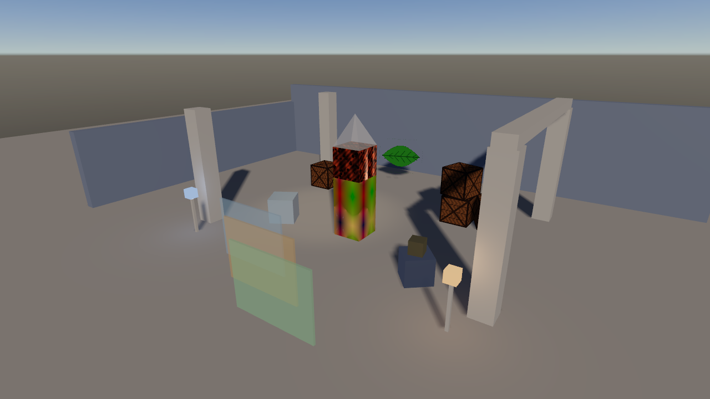

# Fynkel Showcase

The renderer's example scene: one project that exercises what
`fynkel_render` can do, so every renderer milestone has a picture to look
at and compare. It is a normal Fynkel game (created by `fynkel create`,
then authored): a Flutter app plus `fynkel.project.json`, an `assets/`
tree of strict JSON documents and the Fynkel CLI.



What is in the scene (`assets/scenes/main.scene.json`):

- a low evening **sun** (4 000 lux, 32° up) casting the one shadow map,
  long shadows from the pillars, the ledge and the robot; two crates show
  the per-mesh opt-outs (`Crate No Cast`, `Crate No Receive`)
- a warm **spot light** over the robot, a warm and a cool **point light**
  on lamp posts with emissive lamp cubes
- an **`Environment`** with a generated equirectangular **sky**
  (`textures/sky.png`) and a blue-tinted constant ambient
- **materials**: a rough floor and walls, textured crates (`crate.png`),
  the rusted robot head with base colour, normal and metallic-roughness
  maps, gold and chrome blocks (metals without image-based lighting are
  dark — a later item), three overlapping **blend** glass panels and a
  glass cube (the transparent sort), a **mask** leaf card (`leaf.png`,
  double-sided)
- the **robot** from the fixture glTF, re-authored as a hierarchy (body
  in the glTF's own textured material, rusted head, the antenna pyramid)
  spinning under the spot (`game.Spinner`)
- a **camera** that orbits the scene (`game.Orbit`, `lib/game/orbit.dart`)
  so shadows and the transparent sort are seen moving; its authored
  transform is the orbit's start pose, so `fynkel render` (which runs no
  Dart) shows the same view the app opens on
- three **quality profiles** (`low`: no shadows, MSAA 1, scale 0.75;
  `medium`: 2048² shadows, MSAA 4; `high`: 4096², MSAA 4, scale 1.5,
  anisotropy 16)

```sh
fynkel run                       # validate, cook, then the app: Q cycles quality, Space pauses the orbit, A/D (or a stick) scrub it
fynkel run -d <iphone>           # the same on a device: the app carries the cooked cache (fynkel_cache/) as assets
fynkel render --out render.png   # the same view as a PNG; --quality low|medium|high
fynkel validate                  # documents, references, lock
fynkel test --headless           # the scene on the Rust headless host (no Dart, no GPU)
flutter test                     # test/game_test.dart: the scene loads, the robot spins, the camera orbits
```

The HUD (`lib/main.dart`) prints the frame rate (`fps`, with the frame
interval's p50 and p99) and the frame counts the viewport reports —
instances drawn in how many draws (one per `(mesh, material)` pair plus
one per blended instance), how many were culled, lights kept and
dropped, shadow casters and draws and the map size, the internal render
size and MSAA, GPU and CPU time — so a change in the renderer is visible
as a number as well as a picture. Watch the culled count rise and fall
as the orbit turns: what is behind the camera is never uploaded.

## Renders

`renders/<item>.png` is `fynkel render --project examples/showcase` at
1280×720 with the project's default profile, committed at the end of each
renderer item so the history is a before/after:

| Render | After |
| --- | --- |
| `m3-05.png` | M3-05 — Renderer V1 (b): shadows, transparency, MSAA, quality |
| `m3-06.png` | M3-06 — Renderer V1 (c): instancing and frustum culling (byte-identical to `m3-05.png` — culling changes counts, never pixels: 27 instances in 16 draws, 0 culled from the start pose) |

To regenerate: `fynkel render --project examples/showcase --out examples/showcase/renders/<item>.png`.

Gameplay is Dart: `lib/game/*.dart` are `Behaviour` classes with `@Expose`
fields that the scene sets. After changing an exposed field, an id or
adding a behaviour class, run `fynkel codegen --project .` and commit the
regenerated `lib/generated/` and `schemas/behaviours/`. `AGENTS.md`
describes the layout, every command and the validate → codegen → build →
test loop.
